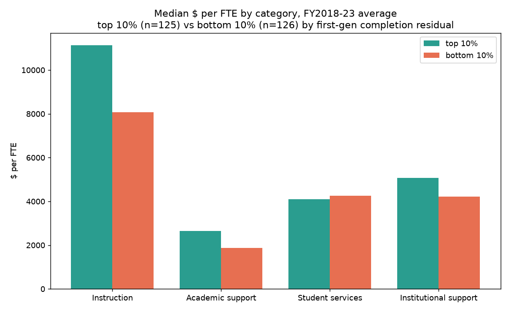

# Which 4-year colleges graduate first-generation students above prediction, and what do they spend on?

Portfolio project (UCSD MSBA application). Python · DuckDB · pandas · statsmodels · plotly · Streamlit.

## Question

Which US 4-year colleges graduate first-generation students at higher rates than their student mix and structure predict, and how did their spending differ, during the years those students were enrolled, from schools that under-perform?

## Headline results (all numbers generated by the pipeline; see `reports/results.json`)

- **Cohort alignment:** outcome = first-gen students who entered in AY2017-18, measured in AY2023-24 (Scorecard cohort map). Predictors are the schools' 2017-18 values; spending is the FY2018-FY2023 average per FTE.
- **Sample:** 1,251 four-year public and private nonprofit colleges (Carnegie doctoral, master's, baccalaureate); 50 special-focus schools scored separately.
- **Model:** OLS of first-gen same-institution 6-year completion on Pell share, admission rate, log enrollment, part-time share, first-gen share, private, HBCU, distance-only and Carnegie group. **R² = 0.489**, HC3 robust SEs. Spending is not in the model.
- **Ranking:** residual = actual − predicted. Top decile (125 schools) beat prediction by **≥ 13.6 points**.
- **Spending:** top-decile schools spent **1.38× more per FTE on instruction** and **1.42× on academic support** than bottom-decile schools (medians; Mann-Whitney p < 0.001). Student-services dollars were not different (0.97×, p = 0.84). Within publics alone, over-performers spent more on all four categories.
- **Robustness:** 1,000-resample bootstrap keeps the top-decile schools in the top decile 93% of the time; separate public and private models rank schools consistently with the pooled model (Spearman 0.94 / 0.97).



## What changed after review (see `decisions.md`)

The first build used the Scorecard's undated download (an August 2024 file), today's school traits, FY2023 spending and no Carnegie control. Review found four problems: spending measured after the cohort left, ambiguity about whether spending sat inside the model, nursing and health colleges dominating the ranking, and a weak robustness check. All four are fixed; only 7 of the original top-20 schools survive in the corrected ranking (Spearman 0.68), while the instruction and academic-support finding held. The original ranking is archived in `reports/archive/`.

## Data

| Source | File(s) | Role |
|---|---|---|
| College Scorecard (US Dept. of Education), Oct 2026 release | Most-Recent-Cohorts-Institution_10152026.csv; MERGED2017_18_PP.csv from the raw archive | outcome (first-gen completion, 2017-18 cohort); entry-year Pell share, admission rate, enrollment, part-time share |
| IPEDS (NCES) | HD2023, IC2023; F1718-F2223 finance (F1A public, F2 private nonprofit); EFIA2018-2023 | 4-year filter, Carnegie 2018, open-admission flag, FY2018-23 functional expenses per FTE |
| Opportunity Insights | mrc_table2, mrc_table11 | mobility rate and parent income (context) |

Join key: `UNITID`. Opportunity Insights is reached via OPEID → `super_opeid`. Raw files are gitignored; `src/01_download.py` recreates them (~600 MB, mostly the Scorecard raw archive).

## Reproduce

```bash
python3 -m venv .venv && source .venv/bin/activate
pip install -r requirements.txt
for s in src/0[1-8]_*.py src/10_memo.py; do python "$s"; done
streamlit run app/app.py
```

## Pipeline (one script per build step)

| Step | Script | Output |
|---|---|---|
| 1 | `src/01_download.py` | `data/raw/`, `reports/01_raw_inventory.md` (row counts, columns) |
| 2 | `src/columns.py`, `src/02_columns.py` | `reports/02_column_selection.md` (every column, plain description, timing) |
| 3 | `src/03_join.py` | `data/clean/joined.parquet`, `finance_by_year.parquet`, `reports/03_join_report.md` (drop funnel) |
| 4 | `src/04_clean.py` | `data/clean/analysis.parquet`, `reports/04_data_quality.md` |
| 5 | `src/05_regress.py` | `reports/05_regression.md`, diagnostic plots in `reports/figures/` |
| 6 | `src/06_rank.py` | `data/clean/ranked_schools.csv`, `reports/06_rankings.md` (incl. before/after the fixes) |
| 7 | `src/07_spending.py` | `reports/07_spending_comparison.md` |
| 8 | `src/08_robustness.py` | `reports/08_robustness.md`, `data/clean/bootstrap_ranks.csv` |
| 9 | `app/app.py` | Streamlit dashboard |
| 10 | `src/10_memo.py` | `memo/memo.md`, this README |

`decisions.md` logs every modeling and cleaning choice with its reason. `reports/results.json` holds the key numbers the memo, README and dashboard read.

## Dashboard

`streamlit run app/app.py`: actual-vs-predicted scatter with hover, coefficient chart, filterable ranking (state, sector, Carnegie group, size, Pell share) with CSV download, top-vs-bottom spending comparison (pooled and sector models), per-school lookup with bootstrap rank interval and peer comparison, methods and limitations.

## Limitations

- **School-level data.** Institutions, not students, are the unit. Unobserved differences in program mix and preparation can produce a residual unrelated to what the school does. Special-focus colleges are excluded for this reason and listed in `reports/05_regression.md`.
- **Correlation only.** Spending differences describe over-performers; they do not show that changing spending would change completion.
- **Outcome definition.** Completion at the same institution for federal-aid students; transfer-out completers count as non-completers. Privacy suppression removes the smallest schools.
- **Structural traits** (control, level, Title IV status, open admission) come from 2023 IPEDS files and are assumed unchanged since 2017.
- **Opportunity Insights** data describe students born 1980-82 and are used as context only.

## Repository layout

```
app/        Streamlit dashboard
data/raw/   downloaded sources (gitignored)   data/clean/  joined, cleaned, scored datasets
memo/       one-page memo to a student success director
notebooks/  exploration notebook
reports/    step-by-step reports, figures, results.json, archive/ (pre-review ranking)
src/        numbered pipeline scripts
CLAUDE.md   original project brief      decisions.md  decisions log
```
