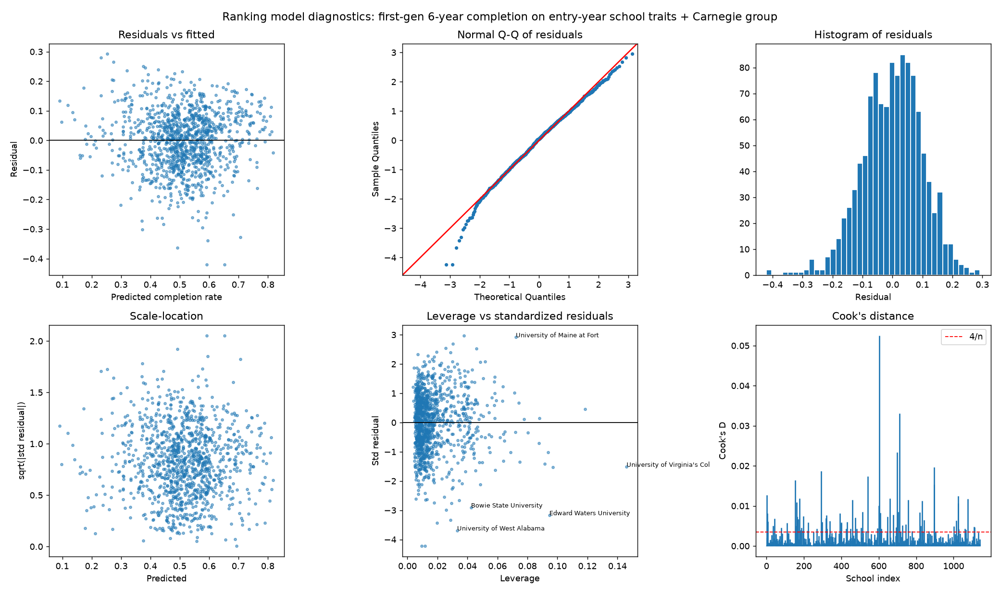
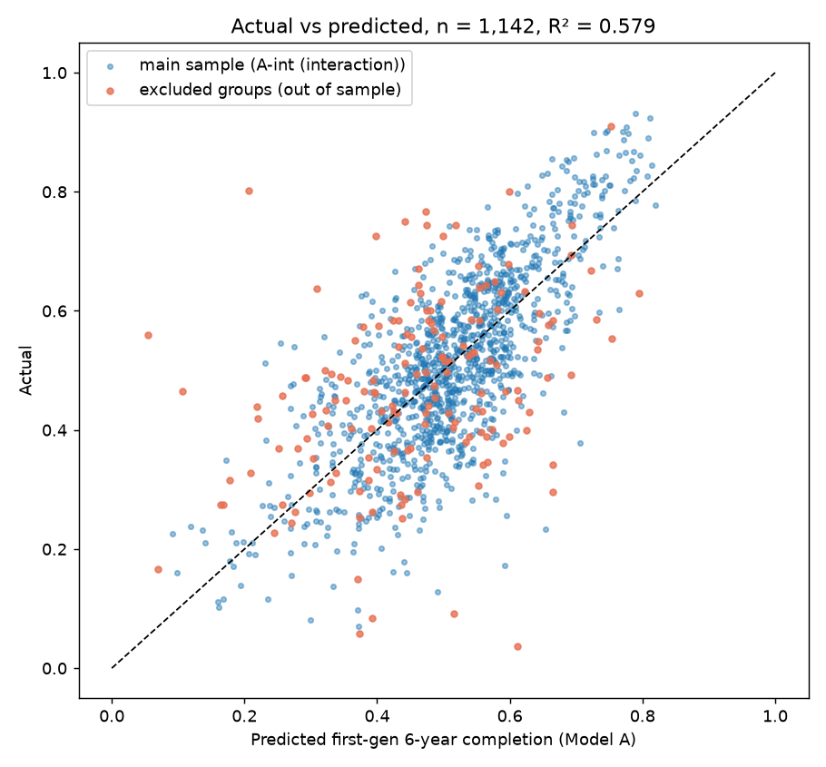

# Regression (Step 5)

Generated by `src/05_regress.py`. Outcome: share of first-generation federal-aid students in the AY2017-18 entry cohort who completed at the same institution within 6 years (0-1). Predictors are the school's 2017-18 values. Standard errors are HC3 robust. Main sample excludes Carnegie special-focus / tribal schools and campuses with more than 50% of undergraduates aged 25+ or exclusively online in Fall 2017.

## Model A (main): entry-year traits + Carnegie group, no spending — n = 1,142, R² = 0.552, adj. R² = 0.548, residual SD = 0.103

| term                                  |    coef |   robust_se | p_value   |   ci_low |   ci_high |
|:--------------------------------------|--------:|------------:|:----------|---------:|----------:|
| Intercept (Master's, public)          |  0.269  |      0.055  | <0.001    |   0.1611 |    0.3769 |
| Carnegie: Baccalaureate (vs Master's) | -0.0108 |      0.0089 | 0.226     |  -0.0283 |    0.0067 |
| Carnegie: Doctoral (vs Master's)      | -0.007  |      0.0087 | 0.421     |  -0.0241 |    0.0101 |
| Pell share (0-1)                      | -0.3513 |      0.036  | <0.001    |  -0.4218 |   -0.2808 |
| Admission rate (0-1)                  | -0.1659 |      0.0174 | <0.001    |  -0.1999 |   -0.1318 |
| log(undergrad enrollment)             |  0.061  |      0.0055 | <0.001    |   0.0503 |    0.0717 |
| Part-time share (0-1)                 | -0.2964 |      0.0632 | <0.001    |  -0.4202 |   -0.1725 |
| First-gen share (0-1)                 | -0.0942 |      0.0651 | 0.148     |  -0.2218 |    0.0334 |
| Share of undergrads aged 25+ (0-1)    |  0.2212 |      0.0691 | 0.001     |   0.0858 |    0.3566 |
| Share exclusively online (0-1)        | -0.2249 |      0.0464 | <0.001    |  -0.3158 |   -0.1339 |
| Private nonprofit (vs public)         |  0.0714 |      0.0096 | <0.001    |   0.0526 |    0.0902 |
| HBCU                                  | -0.0909 |      0.0186 | <0.001    |  -0.1273 |   -0.0545 |

Reading the coefficients: the Pell coefficient is -0.351, so a school with a 40-point higher Pell share (0.20 vs 0.60) is predicted 14.1 points lower on first-gen completion, holding the other traits fixed.

## Model A-int: Model A + private × each trait (Carnegie dummies shared) — n = 1,142, R² = 0.579

| term                                  |    coef |   robust_se | p_value   |   ci_low |   ci_high |
|:--------------------------------------|--------:|------------:|:----------|---------:|----------:|
| Intercept (Master's, public)          |  0.2001 |      0.0786 | 0.011     |   0.0461 |    0.3542 |
| Carnegie: Baccalaureate (vs Master's) | -0.0013 |      0.0095 | 0.887     |  -0.0199 |    0.0172 |
| Carnegie: Doctoral (vs Master's)      |  0.0011 |      0.0085 | 0.897     |  -0.0156 |    0.0179 |
| Pell share (0-1)                      | -0.2507 |      0.0489 | <0.001    |  -0.3465 |   -0.155  |
| Admission rate (0-1)                  | -0.2194 |      0.0305 | <0.001    |  -0.2792 |   -0.1595 |
| log(undergrad enrollment)             |  0.0621 |      0.0073 | <0.001    |   0.0479 |    0.0763 |
| Part-time share (0-1)                 | -0.4204 |      0.1166 | <0.001    |  -0.6489 |   -0.1919 |
| First-gen share (0-1)                 |  0.1661 |      0.0753 | 0.027     |   0.0185 |    0.3137 |
| Share of undergrads aged 25+ (0-1)    |  0.0837 |      0.1177 | 0.477     |  -0.147  |    0.3145 |
| Share exclusively online (0-1)        | -0.131  |      0.0869 | 0.132     |  -0.3012 |    0.0393 |
| Private nonprofit (vs public)         |  0.2275 |      0.0951 | 0.017     |   0.0412 |    0.4139 |
| HBCU                                  | -0.0949 |      0.0237 | <0.001    |  -0.1413 |   -0.0484 |
| Private × Pell share                  | -0.1556 |      0.069  | 0.024     |  -0.2908 |   -0.0204 |
| Private × admission rate              |  0.0981 |      0.0377 | 0.009     |   0.0241 |    0.172  |
| Private × log enrollment              | -0.0099 |      0.0088 | 0.264     |  -0.0271 |    0.0074 |
| Private × part-time share             |  0.202  |      0.1403 | 0.150     |  -0.073  |    0.4769 |
| Private × first-gen share             | -0.4486 |      0.1208 | <0.001    |  -0.6854 |   -0.2118 |
| Private × share aged 25+              |  0.2362 |      0.1465 | 0.107     |  -0.051  |    0.5234 |
| Private × share online                | -0.1083 |      0.1036 | 0.296     |  -0.3113 |    0.0947 |
| Private × HBCU                        |  0.0005 |      0.0359 | 0.990     |  -0.07   |    0.0709 |

### Which model ranks schools? Shrunken-residual rankings compared (top-decile overlap computed within sector)

| Comparison | Spearman | Top-decile overlap |
|---|---:|---:|
| Interaction vs pooled (all schools) | 0.968 | 82% |
| Pooled vs public-only model (publics) | 0.946 | 65% |
| Interaction vs public-only model (publics) | 0.995 | 96% |
| Pooled vs private-only model (privates) | 0.978 | 82% |
| Interaction vs private-only model (privates) | 0.999 | 97% |

### Joint test of the 8 private × trait terms (Wald F with HC3 covariance)

F(8, 1122) = 7.38, p < 0.001. The slopes differ by sector: the interaction terms are jointly significant.

Main model = A-int (interaction). The Wald test above is the reason: the slopes differ by sector. The overlap rule in code (adopt the interaction model if its top decile overlaps BOTH sector-only rankings better than the pooled model's: met) describes what the choice does rather than justifying it, because the interaction model nests the sector slopes and is bound to sit close to the sector rankings.

## Specification comparisons on the same 1,142 schools

- Model A without Carnegie dummies: R² = 0.552.
- Previous spec (distance-only flag instead of the age-25+ and exclusively-online shares): R² = 0.541.
- Original spec (no Carnegie, distance-only flag) on all 1,301 schools including excluded groups: R² = 0.470.

## Model B: Model A + log core spending per FTE (FY2018-23 average) + undergraduate share of FTE — n = 1,142, R² = 0.615 (Model A: 0.552)

| term                                    |    coef |   robust_se | p_value   |   ci_low |   ci_high |
|:----------------------------------------|--------:|------------:|:----------|---------:|----------:|
| Intercept (Master's, public)            | -0.7869 |      0.1377 | <0.001    |  -1.0567 |   -0.5171 |
| Carnegie: Baccalaureate (vs Master's)   | -0.0083 |      0.0102 | 0.412     |  -0.0283 |    0.0116 |
| Carnegie: Doctoral (vs Master's)        | -0.0195 |      0.0093 | 0.036     |  -0.0377 |   -0.0013 |
| Pell share (0-1)                        | -0.1692 |      0.0497 | <0.001    |  -0.2666 |   -0.0719 |
| Admission rate (0-1)                    | -0.1928 |      0.0289 | <0.001    |  -0.2495 |   -0.1361 |
| log(undergrad enrollment)               |  0.0651 |      0.0069 | <0.001    |   0.0517 |    0.0786 |
| Part-time share (0-1)                   | -0.2845 |      0.1108 | 0.010     |  -0.5017 |   -0.0673 |
| First-gen share (0-1)                   |  0.1719 |      0.0709 | 0.015     |   0.0329 |    0.3109 |
| Share of undergrads aged 25+ (0-1)      | -0.0407 |      0.109  | 0.709     |  -0.2543 |    0.1729 |
| Share exclusively online (0-1)          | -0.0667 |      0.0826 | 0.419     |  -0.2287 |    0.0952 |
| Private nonprofit (vs public)           |  0.1781 |      0.0882 | 0.044     |   0.0052 |    0.351  |
| HBCU                                    | -0.1185 |      0.0246 | <0.001    |  -0.1667 |   -0.0704 |
| Private × Pell share                    | -0.1106 |      0.0645 | 0.086     |  -0.237  |    0.0157 |
| Private × admission rate                |  0.1334 |      0.0355 | <0.001    |   0.0638 |    0.203  |
| Private × log enrollment                | -0.0119 |      0.0083 | 0.152     |  -0.0281 |    0.0044 |
| Private × part-time share               |  0.099  |      0.1348 | 0.463     |  -0.1653 |    0.3633 |
| Private × first-gen share               | -0.4293 |      0.1088 | <0.001    |  -0.6426 |   -0.216  |
| Private × share aged 25+                |  0.3092 |      0.1362 | 0.023     |   0.0423 |    0.5762 |
| Private × share online                  | -0.0677 |      0.0979 | 0.489     |  -0.2594 |    0.1241 |
| Private × HBCU                          | -0.0182 |      0.0335 | 0.586     |  -0.084  |    0.0475 |
| log(core spending per FTE, FY18-23 avg) |  0.0959 |      0.0102 | <0.001    |   0.0758 |    0.116  |
| Undergraduate share of total FTE (0-1)  | -0.0291 |      0.0354 | 0.412     |  -0.0985 |    0.0404 |

A 10% higher core budget per student is associated with +0.91 percentage points of first-gen completion, holding Model A traits and the undergraduate share fixed (without the undergraduate-share control: +0.93 points, R² 0.615). Adding spending raises R² by 0.063. The undergraduate-share coefficient is -0.029 (p = 0.412): per-FTE spending at graduate-heavy universities partly serves graduate students, and this term absorbs that.

## Model B-mix: Model B + instruction share and academic-support share of core spending — n = 1,142, R² = 0.621

| term                                    |    coef |   robust_se | p_value   |   ci_low |   ci_high |
|:----------------------------------------|--------:|------------:|:----------|---------:|----------:|
| Intercept (Master's, public)            | -0.8581 |      0.1455 | <0.001    |  -1.1432 |   -0.5729 |
| Carnegie: Baccalaureate (vs Master's)   | -0.0087 |      0.0101 | 0.388     |  -0.0284 |    0.011  |
| Carnegie: Doctoral (vs Master's)        | -0.0225 |      0.0093 | 0.016     |  -0.0408 |   -0.0042 |
| Pell share (0-1)                        | -0.1714 |      0.0497 | <0.001    |  -0.2688 |   -0.0739 |
| Admission rate (0-1)                    | -0.1917 |      0.0287 | <0.001    |  -0.2479 |   -0.1355 |
| log(undergrad enrollment)               |  0.0589 |      0.007  | <0.001    |   0.0451 |    0.0727 |
| Part-time share (0-1)                   | -0.2932 |      0.113  | 0.009     |  -0.5146 |   -0.0717 |
| First-gen share (0-1)                   |  0.1943 |      0.0726 | 0.007     |   0.052  |    0.3366 |
| Share of undergrads aged 25+ (0-1)      | -0.0409 |      0.1089 | 0.707     |  -0.2543 |    0.1724 |
| Share exclusively online (0-1)          | -0.0634 |      0.0819 | 0.439     |  -0.2238 |    0.0971 |
| Private nonprofit (vs public)           |  0.2239 |      0.0893 | 0.012     |   0.0489 |    0.3988 |
| HBCU                                    | -0.1056 |      0.0243 | <0.001    |  -0.1533 |   -0.0579 |
| Private × Pell share                    | -0.1144 |      0.0635 | 0.072     |  -0.2389 |    0.0101 |
| Private × admission rate                |  0.1326 |      0.0352 | <0.001    |   0.0636 |    0.2016 |
| Private × log enrollment                | -0.0155 |      0.0084 | 0.065     |  -0.032  |    0.001  |
| Private × part-time share               |  0.1127 |      0.1359 | 0.407     |  -0.1536 |    0.379  |
| Private × first-gen share               | -0.4176 |      0.109  | <0.001    |  -0.6312 |   -0.2039 |
| Private × share aged 25+                |  0.3023 |      0.1348 | 0.025     |   0.038  |    0.5666 |
| Private × share online                  | -0.0536 |      0.0963 | 0.578     |  -0.2424 |    0.1351 |
| Private × HBCU                          | -0.0199 |      0.0329 | 0.545     |  -0.0844 |    0.0446 |
| log(core spending per FTE, FY18-23 avg) |  0.0941 |      0.0107 | <0.001    |   0.0732 |    0.115  |
| Undergraduate share of total FTE (0-1)  | -0.0031 |      0.0364 | 0.931     |  -0.0745 |    0.0682 |
| instr_share                             |  0.1617 |      0.0467 | <0.001    |   0.0701 |    0.2533 |
| acad_share                              |  0.1914 |      0.0636 | 0.003     |   0.0667 |    0.3162 |

**How much of over-performance is money.** The ranking model leaves 42.1% of the variance in first-gen completion unexplained. Spending level alone removes 8.7% of that remainder (partial R² of Model B), level plus mix removes 10.0% (Model B-mix), and mix without level 2.3%. Doubling core spending per student is associated with +6.5 points, one SD more academic-support share (0.058) with +1.11 points (p = 0.003) and one SD more instruction share (0.102) with +1.65 points (p = 0.001), all with the student mix, size, type and sector held fixed. This replaces the earlier regression of the shrunken residual on raw spending (kept in Step 7 as a sensitivity), which understated the coefficient because spending overlaps the traits already in the model. **Verdict: the mix matters with the level fixed.** The memo headline reads this block from results.json.

## Model C: Model A + SAT average, SAT-reporting schools only — n = 969, R² = 0.592 (Model A on same schools: 0.551)

| term                                  |    coef |   robust_se | p_value   |   ci_low |   ci_high |
|:--------------------------------------|--------:|------------:|:----------|---------:|----------:|
| Intercept (Master's, public)          | -0.4361 |      0.1128 | <0.001    |  -0.6572 |   -0.2151 |
| Carnegie: Baccalaureate (vs Master's) |  0.0008 |      0.0101 | 0.939     |  -0.019  |    0.0205 |
| Carnegie: Doctoral (vs Master's)      | -0.0179 |      0.0091 | 0.049     |  -0.0357 |   -0.0001 |
| Pell share (0-1)                      | -0.092  |      0.0625 | 0.141     |  -0.2144 |    0.0305 |
| Admission rate (0-1)                  | -0.1273 |      0.034  | <0.001    |  -0.194  |   -0.0606 |
| log(undergrad enrollment)             |  0.0482 |      0.0078 | <0.001    |   0.0329 |    0.0635 |
| Part-time share (0-1)                 | -0.2393 |      0.1143 | 0.036     |  -0.4634 |   -0.0152 |
| First-gen share (0-1)                 |  0.2557 |      0.089  | 0.004     |   0.0813 |    0.4301 |
| Share of undergrads aged 25+ (0-1)    |  0.0272 |      0.1148 | 0.813     |  -0.1979 |    0.2523 |
| Share exclusively online (0-1)        | -0.1563 |      0.0876 | 0.074     |  -0.3279 |    0.0153 |
| Private nonprofit (vs public)         |  0.1133 |      0.1035 | 0.273     |  -0.0895 |    0.3161 |
| HBCU                                  | -0.0441 |      0.0239 | 0.065     |  -0.0908 |    0.0027 |
| Private × Pell share                  | -0.1406 |      0.0911 | 0.123     |  -0.3191 |    0.038  |
| Private × admission rate              |  0.1108 |      0.0386 | 0.004     |   0.0352 |    0.1864 |
| Private × log enrollment              | -0.0033 |      0.0099 | 0.740     |  -0.0227 |    0.0161 |
| Private × part-time share             |  0.0987 |      0.1478 | 0.504     |  -0.191  |    0.3885 |
| Private × first-gen share             | -0.3205 |      0.1349 | 0.018     |  -0.5849 |   -0.056  |
| Private × share aged 25+              |  0.2834 |      0.1485 | 0.056     |  -0.0077 |    0.5745 |
| Private × share online                | -0.0545 |      0.1042 | 0.601     |  -0.2588 |    0.1497 |
| Private × HBCU                        | -0.0194 |      0.0416 | 0.641     |  -0.101  |    0.0622 |
| SAT average (points)                  |  0.0005 |      0.0001 | <0.001    |   0.0004 |    0.0007 |

## Multicollinearity (VIF, Model A)

| term                         |   VIF | flag   |
|:-----------------------------|------:|:-------|
| pctpell                      |  2.46 |        |
| adm_rate                     |  1.09 |        |
| log_ugds                     |  3.41 |        |
| pptug_ef                     |  3.72 |        |
| first_gen                    |  2.72 |        |
| ug25abv                      |  5.06 | > 5    |
| pct_distance                 |  1.79 |        |
| private                      |  2.28 |        |
| hbcu_flag                    |  1.46 |        |
| carnegie_group_Baccalaureate |  1.63 |        |
| carnegie_group_Doctoral      |  1.66 |        |

## Diagnostics (Model A)

- Breusch-Pagan: LM = 44.7, p = 7.46e-04. Residual spread varies with the predictors; HC3 robust SEs are used.
- Jarque-Bera: JB = 34.0, p = 4.19e-08, skew = -0.33, kurtosis = 3.54. With n = 1,142 inference on coefficients does not rely on normal residuals.
- Influence: 78 schools exceed the 4/n Cook's distance rule of thumb. Step 8 bootstraps the ranking to show how much any single school matters.

Most influential schools:

| instnm                                      | stabbr   |   ugds |   firstgen_comp_orig_yr6_rt |   predicted |   cooks |
|:--------------------------------------------|:---------|-------:|----------------------------:|------------:|--------:|
| Edward Waters University                    | FL       |    946 |                      0.0708 |      0.3725 |  0.0525 |
| University of Maine at Fort Kent            | ME       |   1036 |                      0.5118 |      0.2312 |  0.0331 |
| University of West Alabama                  | AL       |   2106 |                      0.1286 |      0.4916 |  0.0233 |
| University of Virginia's College at Wise    | VA       |   1249 |                      0.2679 |      0.4079 |  0.0196 |
| Bowie State University                      | MD       |   5107 |                      0.1601 |      0.4446 |  0.0187 |
| Heritage University                         | WA       |    778 |                      0.546  |      0.2539 |  0.0174 |
| Georgia Institute of Technology-Main Campus | GA       |  14810 |                      0.3781 |      0.7062 |  0.0164 |
| University of Houston-Clear Lake            | TX       |   5781 |                      0.6287 |      0.3826 |  0.0153 |

## Excluded schools (159), scored out-of-sample with Model A and NOT ranked with the main sample

Four groups. (1) Carnegie special-focus / tribal (codes 24-33: faith, medical, health professions, engineering, technology, business, arts, law, other, tribal), scored at the Master's Carnegie baseline: 50 schools. (2) Campuses where more than 50% of Fall 2017 undergraduates were aged 25+ or exclusively online: 49 schools. (3) Schools whose Scorecard completion rates are implausible against their IPEDS graduation rate (both first-gen and non-first-gen below 25% of C150_4): 4 schools. (4) Campuses whose first-gen outcome is pooled with other campuses under one 6-digit OPEID and whose own undergraduates are under 90% of that group: 56 schools. The first two serve populations and run programs the main model does not describe; the last two carry outcomes that are not the campus's own. All residuals are shown for transparency only.

| excluded_reason                               | instnm                                                             | stabbr   |   hd_c18basic |   ugds |   ug25abv |   pct_distance |   pctpell |   firstgen_comp_orig_yr6_rt |   predicted |   residual |
|:----------------------------------------------|:-------------------------------------------------------------------|:---------|--------------:|-------:|----------:|---------------:|----------:|----------------------------:|------------:|-----------:|
| adult (25+) or online share > 50%             | University of Florida-Online                                       | FL       |            22 |   2735 |     0.503 |          1     |     0.318 |                       0.801 |       0.206 |      0.595 |
| adult (25+) or online share > 50%             | Charter Oak State College                                          | CT       |            21 |   1352 |     0.905 |          1     |     0.313 |                       0.559 |       0.054 |      0.505 |
| adult (25+) or online share > 50%             | University of New Hampshire College of Professional Studies Online | NH       |            20 |   1676 |     0.779 |          0.779 |     0.431 |                       0.464 |       0.106 |      0.358 |
| adult (25+) or online share > 50%             | Touro University Worldwide                                         | CA       |            18 |    509 |     0.643 |          0.87  |     0.514 |                       0.439 |       0.218 |      0.22  |
| adult (25+) or online share > 50%             | Humphreys University                                               | CA       |            22 |    319 |     0.515 |          0.015 |     0.658 |                       0.457 |       0.257 |      0.2   |
| adult (25+) or online share > 50%             | University of Massachusetts Global                                 | CA       |            17 |   3502 |     0.848 |          0.727 |     0.396 |                       0.42  |       0.22  |      0.2   |
| adult (25+) or online share > 50%             | Metropolitan State University                                      | MN       |            17 |   7080 |     0.659 |          0.182 |     0.423 |                       0.55  |       0.367 |      0.183 |
| adult (25+) or online share > 50%             | Whitworth University-Adult Degree Programs                         | WA       |            22 |    313 |     0.923 |          0     |     0.55  |                       0.643 |       0.462 |      0.181 |
| adult (25+) or online share > 50%             | Governors State University                                         | IL       |            18 |   3288 |     0.51  |          0.134 |     0.521 |                       0.49  |       0.344 |      0.146 |
| adult (25+) or online share > 50%             | University of Maine at Augusta                                     | ME       |            22 |   3244 |     0.609 |          0.505 |     0.462 |                       0.315 |       0.177 |      0.138 |
| adult (25+) or online share > 50%             | Indiana University-East                                            | IN       |            20 |   2969 |     0.429 |          0.518 |     0.3   |                       0.484 |       0.356 |      0.128 |
| adult (25+) or online share > 50%             | Fort Hays State University                                         | KS       |            18 |  12174 |     0.306 |          0.659 |     0.28  |                       0.427 |       0.302 |      0.125 |
| adult (25+) or online share > 50%             | Herzing University-Atlanta                                         | GA       |            20 |    593 |     0.794 |          0.562 |     0.721 |                       0.369 |       0.252 |      0.116 |
| adult (25+) or online share > 50%             | University of Baltimore                                            | MD       |            18 |   2856 |     0.503 |          0.098 |     0.433 |                       0.45  |       0.336 |      0.114 |
| adult (25+) or online share > 50%             | Mayville State University                                          | ND       |            22 |    825 |     0.279 |          0.525 |     0.293 |                       0.434 |       0.323 |      0.111 |
| adult (25+) or online share > 50%             | Amridge University                                                 | AL       |            20 |    318 |     0.83  |          1     |     0.742 |                       0.167 |       0.069 |      0.098 |
| adult (25+) or online share > 50%             | The University of Texas Permian Basin                              | TX       |            18 |   3730 |     0.243 |          0.527 |     0.284 |                       0.386 |       0.294 |      0.092 |
| adult (25+) or online share > 50%             | Empire State University                                            | NY       |            18 |   8622 |     0.806 |          0.467 |     0.317 |                       0.352 |       0.304 |      0.048 |
| adult (25+) or online share > 50%             | Lakeland University                                                | WI       |            18 |   1835 |     0.563 |          0.048 |     0.333 |                       0.585 |       0.542 |      0.043 |
| adult (25+) or online share > 50%             | Excelsior University                                               | NY       |            18 |  31039 |     0.888 |          1     |     0.102 |                       0.523 |       0.497 |      0.026 |
| adult (25+) or online share > 50%             | National University                                                | CA       |            18 |   7360 |     0.864 |          0.618 |     0.355 |                       0.523 |       0.498 |      0.025 |
| adult (25+) or online share > 50%             | University of Providence                                           | MT       |            22 |    923 |     0.544 |          0.474 |     0.264 |                       0.464 |       0.441 |      0.023 |
| adult (25+) or online share > 50%             | Cambridge College                                                  | MA       |            18 |    742 |     0.823 |          0     |     0.481 |                       0.441 |       0.422 |      0.019 |
| adult (25+) or online share > 50%             | Fresno Pacific University                                          | CA       |            18 |   2791 |     0.558 |          0.096 |     0.577 |                       0.516 |       0.509 |      0.007 |
| adult (25+) or online share > 50%             | Belhaven University                                                | MS       |            18 |   2410 |     0.516 |          0.178 |     0.586 |                       0.429 |       0.43  |     -0.001 |
| adult (25+) or online share > 50%             | University of Maryland Global Campus                               | MD       |            18 |  42289 |     0.757 |          0.758 |     0.248 |                       0.295 |       0.297 |     -0.003 |
| adult (25+) or online share > 50%             | Upper Iowa University                                              | IA       |            18 |   4058 |     0.65  |          0.371 |     0.432 |                       0.497 |       0.505 |     -0.008 |
| adult (25+) or online share > 50%             | Mid-America Christian University                                   | OK       |            19 |   1561 |     0.716 |          0.619 |     0.582 |                       0.328 |       0.338 |     -0.011 |
| adult (25+) or online share > 50%             | Albertus Magnus College                                            | CT       |            19 |   1122 |     0.582 |          0.124 |     0.53  |                       0.475 |       0.486 |     -0.011 |
| adult (25+) or online share > 50%             | Bellevue University                                                | NE       |            18 |   5665 |     0.764 |          0.757 |     0.292 |                       0.531 |       0.546 |     -0.015 |
| adult (25+) or online share > 50%             | Peirce College                                                     | PA       |            22 |   1381 |     0.783 |          0.491 |     0.602 |                       0.228 |       0.245 |     -0.017 |
| adult (25+) or online share > 50%             | City University of Seattle                                         | WA       |            18 |    767 |     0.85  |          0.33  |     0.251 |                       0.44  |       0.478 |     -0.037 |
| adult (25+) or online share > 50%             | Indiana Wesleyan University-National & Global                      | IN       |            18 |   6549 |     0.758 |          0.85  |     0.429 |                       0.428 |       0.474 |     -0.046 |
| adult (25+) or online share > 50%             | Chicago State University                                           | IL       |            18 |   2025 |     0.615 |          0.066 |     0.634 |                       0.333 |       0.4   |     -0.066 |
| adult (25+) or online share > 50%             | Nelson University                                                  | TX       |            20 |   1730 |     0.215 |          0.541 |     0.52  |                       0.298 |       0.374 |     -0.076 |
| adult (25+) or online share > 50%             | Wayland Baptist University                                         | TX       |            18 |   3549 |     0.63  |          0.204 |     0.374 |                       0.368 |       0.45  |     -0.081 |
| adult (25+) or online share > 50%             | University of Mount Olive                                          | NC       |            20 |   3061 |     0.586 |          0.08  |     0.501 |                       0.413 |       0.517 |     -0.103 |
| adult (25+) or online share > 50%             | Park University                                                    | MO       |            18 |   9442 |     0.692 |          0.57  |     0.332 |                       0.405 |       0.514 |     -0.109 |
| adult (25+) or online share > 50%             | Regent University                                                  | VA       |            17 |   4087 |     0.61  |          0.698 |     0.509 |                       0.254 |       0.374 |     -0.12  |
| adult (25+) or online share > 50%             | Wilmington University                                              | DE       |            17 |   8346 |     0.599 |          0.408 |     0.312 |                       0.354 |       0.474 |     -0.121 |
| adult (25+) or online share > 50%             | Metropolitan College of New York                                   | NY       |            18 |    772 |     0.786 |          0.028 |     0.759 |                       0.291 |       0.435 |     -0.144 |
| adult (25+) or online share > 50%             | Columbia College                                                   | MO       |            18 |  11975 |     0.722 |          0.541 |     0.479 |                       0.284 |       0.442 |     -0.157 |
| adult (25+) or online share > 50%             | Southern New Hampshire University                                  | NH       |            18 |  68214 |     0.75  |          0.921 |     0.45  |                       0.296 |       0.461 |     -0.164 |
| adult (25+) or online share > 50%             | Everglades University                                              | FL       |            19 |   2099 |     0.847 |          0.578 |     0.442 |                       0.401 |       0.573 |     -0.173 |
| adult (25+) or online share > 50%             | Bethel University                                                  | TN       |            18 |   3975 |     0.54  |          0.435 |     0.505 |                       0.252 |       0.438 |     -0.186 |
| adult (25+) or online share > 50%             | Western Governors University                                       | UT       |            18 |  72385 |     0.914 |          1     |     0.293 |                       0.492 |       0.692 |     -0.2   |
| adult (25+) or online share > 50%             | Liberty University                                                 | VA       |            17 |  45364 |     0.551 |          0.705 |     0.456 |                       0.346 |       0.567 |     -0.221 |
| adult (25+) or online share > 50%             | Indiana Institute of Technology                                    | IN       |            19 |   6899 |     0.672 |          0.566 |     0.665 |                       0.149 |       0.371 |     -0.222 |
| adult (25+) or online share > 50%             | Saint Leo University                                               | FL       |            18 |   9404 |     0.682 |          0.535 |     0.418 |                       0.307 |       0.553 |     -0.246 |
| outcome implausible vs IPEDS grad rate        | Huston-Tillotson University                                        | TX       |            22 |   1052 |     0.383 |          0     |     0.633 |                       0.085 |       0.392 |     -0.307 |
| outcome implausible vs IPEDS grad rate        | University of Guam                                                 | GU       |            19 |   3533 |     0.202 |          0.009 |     0.471 |                       0.058 |       0.373 |     -0.314 |
| outcome implausible vs IPEDS grad rate        | Marian University                                                  | WI       |            19 |   1495 |     0.243 |          0.099 |     0.299 |                       0.092 |       0.515 |     -0.423 |
| outcome implausible vs IPEDS grad rate        | San Jose State University                                          | CA       |            18 |  27591 |     0.179 |          0.009 |     0.41  |                       0.038 |       0.612 |     -0.574 |
| outcome pooled across campuses (shared OPEID) | Warner Pacific University                                          | OR       |            22 |    398 |     0.088 |          0     |     0.517 |                       0.637 |       0.309 |      0.328 |
| outcome pooled across campuses (shared OPEID) | Rutgers University-Camden                                          | NJ       |            16 |   5360 |     0.304 |          0.086 |     0.431 |                       0.744 |       0.474 |      0.269 |
| outcome pooled across campuses (shared OPEID) | Rutgers University-Newark                                          | NJ       |            16 |   8122 |     0.209 |          0.009 |     0.5   |                       0.744 |       0.518 |      0.225 |
| outcome pooled across campuses (shared OPEID) | Miami University-Middletown                                        | OH       |            22 |   1519 |     0.188 |          0.13  |     0.292 |                       0.488 |       0.291 |      0.197 |
| outcome pooled across campuses (shared OPEID) | Miami University-Hamilton                                          | OH       |            22 |   2545 |     0.234 |          0.09  |     0.372 |                       0.488 |       0.292 |      0.196 |
| outcome pooled across campuses (shared OPEID) | Bloomfield College of Montclair State University                   | NJ       |            21 |   1833 |     0.163 |          0.02  |     0.684 |                       0.573 |       0.378 |      0.195 |
| outcome pooled across campuses (shared OPEID) | Central Methodist University-College of Liberal Arts and Sciences  | MO       |            22 |   1059 |     0.043 |          0     |     0.388 |                       0.575 |       0.402 |      0.174 |
| outcome pooled across campuses (shared OPEID) | Northeastern University Oakland                                    | CA       |            19 |    757 |     0.144 |          0     |     0.472 |                       0.63  |       0.465 |      0.165 |
| outcome pooled across campuses (shared OPEID) | Northwest University-Center for Online and Extended Education      | WA       |            22 |    641 |     0.341 |          0.466 |     0.319 |                       0.494 |       0.331 |      0.163 |
| outcome pooled across campuses (shared OPEID) | University of Pittsburgh-Greensburg                                | PA       |            21 |   1521 |     0.076 |          0     |     0.346 |                       0.584 |       0.424 |      0.16  |
| outcome pooled across campuses (shared OPEID) | Emory University                                                   | GA       |            15 |   6776 |     0.039 |          0.009 |     0.18  |                       0.91  |       0.752 |      0.158 |
| outcome pooled across campuses (shared OPEID) | University of Pittsburgh-Bradford                                  | PA       |            22 |   1296 |     0.086 |          0.001 |     0.444 |                       0.584 |       0.432 |      0.151 |
| outcome pooled across campuses (shared OPEID) | Caribbean University-Vega Baja                                     | PR       |            22 |    253 |     0.37  |          0     |     0.873 |                       0.274 |       0.164 |      0.11  |
| outcome pooled across campuses (shared OPEID) | Evangel University                                                 | MO       |            19 |   1627 |     0.09  |          0.067 |     0.438 |                       0.54  |       0.432 |      0.108 |
| outcome pooled across campuses (shared OPEID) | University of Pittsburgh-Johnstown                                 | PA       |            22 |   2776 |     0.042 |          0     |     0.303 |                       0.584 |       0.477 |      0.106 |
| outcome pooled across campuses (shared OPEID) | Caribbean University-Carolina                                      | PR       |            22 |    350 |     0.381 |          0     |     0.87  |                       0.274 |       0.168 |      0.106 |
| outcome pooled across campuses (shared OPEID) | University of New Hampshire at Manchester                          | NH       |            21 |    711 |     0.266 |          0.001 |     0.257 |                       0.464 |       0.38  |      0.085 |
| outcome pooled across campuses (shared OPEID) | Wright State University-Lake Campus                                | OH       |            22 |    828 |     0.104 |          0.027 |     0.255 |                       0.407 |       0.326 |      0.082 |
| outcome pooled across campuses (shared OPEID) | Whitworth University                                               | WA       |            19 |   2227 |     0.024 |          0     |     0.233 |                       0.643 |       0.564 |      0.079 |
| outcome pooled across campuses (shared OPEID) | Fairleigh Dickinson University-Metropolitan Campus                 | NJ       |            18 |   3391 |     0.2   |          0.042 |     0.284 |                       0.556 |       0.499 |      0.058 |
| outcome pooled across campuses (shared OPEID) | Rutgers University-New Brunswick                                   | NJ       |            15 |  35296 |     0.076 |          0.01  |     0.294 |                       0.744 |       0.694 |      0.05  |
| outcome pooled across campuses (shared OPEID) | Pontifical Catholic University of Puerto Rico-Ponce                | PR       |            17 |   5239 |     0.102 |          0.029 |     0.794 |                       0.402 |       0.361 |      0.042 |
| outcome pooled across campuses (shared OPEID) | Northwest University                                               | WA       |            19 |    911 |     0.09  |          0.001 |     0.314 |                       0.494 |       0.46  |      0.034 |
| outcome pooled across campuses (shared OPEID) | Washburn University                                                | KS       |            17 |   4926 |     0.201 |          0.081 |     0.331 |                       0.432 |       0.406 |      0.026 |
| outcome pooled across campuses (shared OPEID) | Trine University                                                   | IN       |            19 |   1939 |     0.01  |          0.011 |     0.154 |                       0.603 |       0.581 |      0.021 |
| outcome pooled across campuses (shared OPEID) | Caribbean University-Ponce                                         | PR       |            22 |    653 |     0.424 |          0     |     0.769 |                       0.274 |       0.257 |      0.018 |
| outcome pooled across campuses (shared OPEID) | University of Connecticut                                          | CT       |            15 |  18930 |     0.03  |          0.002 |     0.208 |                       0.694 |       0.692 |      0.003 |
| outcome pooled across campuses (shared OPEID) | Ohio University-Main Campus                                        | OH       |            16 |  22936 |     0.24  |          0.24  |     0.266 |                       0.53  |       0.543 |     -0.014 |
| outcome pooled across campuses (shared OPEID) | Ottawa University-Ottawa                                           | KS       |            22 |    670 |     0.037 |          0.001 |     0.425 |                       0.354 |       0.387 |     -0.033 |
| outcome pooled across campuses (shared OPEID) | Drury University                                                   | MO       |            19 |   2971 |     0.422 |          0.199 |     0.49  |                       0.454 |       0.487 |     -0.033 |
| outcome pooled across campuses (shared OPEID) | Springfield College                                                | MA       |            18 |   2204 |     0.031 |          0     |     0.233 |                       0.517 |       0.57  |     -0.053 |
| outcome pooled across campuses (shared OPEID) | University of Washington-Seattle Campus                            | WA       |            15 |  30295 |     0.082 |          0.011 |     0.213 |                       0.668 |       0.723 |     -0.055 |
| outcome pooled across campuses (shared OPEID) | Montana Technological University                                   | MT       |            20 |   1640 |     0.249 |          0.045 |     0.298 |                       0.364 |       0.425 |     -0.061 |
| outcome pooled across campuses (shared OPEID) | Southern University and A & M College                              | LA       |            18 |   5137 |     0.14  |          0.023 |     0.69  |                       0.315 |       0.387 |     -0.072 |
| outcome pooled across campuses (shared OPEID) | Indiana Wesleyan University-Marion                                 | IN       |            20 |   2685 |     0.034 |          0     |     0.29  |                       0.428 |       0.508 |     -0.08  |
| outcome pooled across campuses (shared OPEID) | University of Pittsburgh-Pittsburgh Campus                         | PA       |            15 |  19134 |     0.055 |          0.002 |     0.157 |                       0.584 |       0.665 |     -0.082 |
| outcome pooled across campuses (shared OPEID) | Arizona State University Campus Immersion                          | AZ       |            15 |  42181 |     0.106 |          0     |     0.293 |                       0.535 |       0.642 |     -0.107 |
| outcome pooled across campuses (shared OPEID) | Kent State University at Kent                                      | OH       |            16 |  22403 |     0.11  |          0.083 |     0.302 |                       0.436 |       0.549 |     -0.113 |
| outcome pooled across campuses (shared OPEID) | University of New Mexico-Main Campus                               | NM       |            15 |  18912 |     0.241 |          0.089 |     0.38  |                       0.431 |       0.558 |     -0.127 |
| outcome pooled across campuses (shared OPEID) | University of New Hampshire-Main Campus                            | NH       |            15 |  12847 |     0.025 |          0.001 |     0.203 |                       0.464 |       0.594 |     -0.13  |
| outcome pooled across campuses (shared OPEID) | Ohio State University-Main Campus                                  | OH       |            15 |  44853 |     0.074 |          0.016 |     0.199 |                       0.586 |       0.731 |     -0.145 |
| outcome pooled across campuses (shared OPEID) | Abilene Christian University                                       | TX       |            18 |   3655 |     0.024 |          0.005 |     0.255 |                       0.466 |       0.611 |     -0.145 |
| outcome pooled across campuses (shared OPEID) | Georgia State University                                           | GA       |            15 |  25031 |     0.183 |          0.005 |     0.493 |                       0.38  |       0.533 |     -0.153 |
| outcome pooled across campuses (shared OPEID) | Johnson & Wales University-Providence                              | RI       |            18 |   7500 |     0.082 |          0     |     0.362 |                       0.397 |       0.557 |     -0.16  |
| outcome pooled across campuses (shared OPEID) | University of Cincinnati-Main Campus                               | OH       |            15 |  25523 |     0.124 |          0.071 |     0.216 |                       0.45  |       0.612 |     -0.163 |
| outcome pooled across campuses (shared OPEID) | Eastern New Mexico University-Main Campus                          | NM       |            18 |   3431 |     0.285 |          0.376 |     0.332 |                       0.274 |       0.437 |     -0.163 |
| outcome pooled across campuses (shared OPEID) | Northeastern University                                            | MA       |            15 |  13666 |     0.012 |          0.002 |     0.122 |                       0.63  |       0.795 |     -0.165 |
| outcome pooled across campuses (shared OPEID) | Miami University-Oxford                                            | OH       |            16 |  16816 |     0.017 |          0.001 |     0.11  |                       0.488 |       0.656 |     -0.168 |
| outcome pooled across campuses (shared OPEID) | Embry-Riddle Aeronautical University-Prescott                      | AZ       |            22 |   2598 |     0.092 |          0.003 |     0.241 |                       0.388 |       0.564 |     -0.176 |
| outcome pooled across campuses (shared OPEID) | West Virginia University                                           | WV       |            15 |  21705 |     0.056 |          0.059 |     0.253 |                       0.429 |       0.629 |     -0.199 |
| outcome pooled across campuses (shared OPEID) | Pennsylvania State University-Main Campus                          | PA       |            15 |  40553 |     0.019 |          0.001 |     0.148 |                       0.553 |       0.753 |     -0.2   |
| outcome pooled across campuses (shared OPEID) | Embry-Riddle Aeronautical University-Daytona Beach                 | FL       |            19 |   5689 |     0.099 |          0.002 |     0.267 |                       0.388 |       0.599 |     -0.211 |
| outcome pooled across campuses (shared OPEID) | Concordia University-Wisconsin                                     | WI       |            17 |   3533 |     0.308 |          0.111 |     0.282 |                       0.379 |       0.59  |     -0.211 |
| outcome pooled across campuses (shared OPEID) | New Mexico State University-Main Campus                            | NM       |            16 |  11173 |     0.205 |          0.076 |     0.414 |                       0.341 |       0.559 |     -0.218 |
| outcome pooled across campuses (shared OPEID) | Bard College                                                       | NY       |            21 |   1846 |     0.015 |          0     |     0.219 |                       0.4   |       0.625 |     -0.225 |
| outcome pooled across campuses (shared OPEID) | Saint Joseph's University - Philadelphia                           | PA       |            18 |   5040 |     0.065 |          0.043 |     0.125 |                       0.295 |       0.665 |     -0.37  |
| special focus / tribal                        | University of Minnesota-Rochester                                  | MN       |            26 |    459 |     0.049 |          0     |     0.331 |                       0.726 |       0.398 |      0.329 |
| special focus / tribal                        | Mount Carmel College of Nursing                                    | OH       |            26 |    878 |     0.327 |          0.206 |     0.255 |                       0.75  |       0.442 |      0.308 |
| special focus / tribal                        | Nebraska Methodist College of Nursing & Allied Health              | NE       |            26 |    861 |     0.442 |          0.182 |     0.317 |                       0.767 |       0.473 |      0.293 |
| special focus / tribal                        | Northwood University                                               | MI       |            29 |   2880 |     0.437 |          0.33  |     0.31  |                       0.726 |       0.499 |      0.227 |
| special focus / tribal                        | Clarkson College                                                   | NE       |            26 |    678 |     0.404 |          0.128 |     0.33  |                       0.671 |       0.462 |      0.209 |
| special focus / tribal                        | Art Center College of Design                                       | CA       |            30 |   1974 |     0.287 |          0     |     0.326 |                       0.8   |       0.598 |      0.202 |
| special focus / tribal                        | Central Yeshiva Tomchei Tmimim Lubavitz                            | NY       |            24 |    453 |     0.016 |          0     |     0.6   |                       0.5   |       0.321 |      0.179 |
| special focus / tribal                        | Massachusetts College of Art and Design                            | MA       |            30 |   1812 |     0.122 |          0.001 |     0.292 |                       0.615 |       0.45  |      0.165 |
| special focus / tribal                        | Kansas City Art Institute                                          | MO       |            30 |    659 |     0.077 |          0     |     0.429 |                       0.6   |       0.475 |      0.125 |
| special focus / tribal                        | Regis College                                                      | MA       |            26 |   1259 |     0.34  |          0     |     0.295 |                       0.675 |       0.552 |      0.123 |
| special focus / tribal                        | Otis College of Art and Design                                     | CA       |            30 |   1056 |     0.133 |          0     |     0.384 |                       0.616 |       0.496 |      0.12  |
| special focus / tribal                        | Methodist College                                                  | IL       |            26 |    675 |     0.533 |          0.04  |     0.464 |                       0.6   |       0.481 |      0.119 |
| special focus / tribal                        | Dewey University-Hato Rey                                          | PR       |            26 |    355 |     0.603 |          0     |     0.959 |                       0.327 |       0.209 |      0.118 |
| special focus / tribal                        | Milwaukee Institute of Art & Design                                | WI       |            30 |    659 |     0.07  |          0     |     0.454 |                       0.561 |       0.444 |      0.116 |
| special focus / tribal                        | Cleary University                                                  | MI       |            29 |    519 |     0.439 |          0.227 |     0.328 |                       0.557 |       0.452 |      0.105 |
| special focus / tribal                        | Cleveland Institute of Art                                         | OH       |            30 |    630 |     0.086 |          0     |     0.406 |                       0.58  |       0.482 |      0.098 |
| special focus / tribal                        | Franklin University                                                | OH       |            29 |   3433 |     0.81  |          0.787 |     0.39  |                       0.45  |       0.353 |      0.098 |
| special focus / tribal                        | AdventHealth University                                            | FL       |            26 |   1316 |     0.478 |          0.213 |     0.368 |                       0.483 |       0.394 |      0.09  |
| special focus / tribal                        | Herzing University-Kenosha                                         | WI       |            26 |    276 |     0.657 |          0.379 |     0.693 |                       0.369 |       0.28  |      0.089 |
| special focus / tribal                        | College for Creative Studies                                       | MI       |            30 |   1347 |     0.129 |          0     |     0.314 |                       0.639 |       0.554 |      0.084 |
| special focus / tribal                        | Kettering College                                                  | OH       |            26 |    615 |     0.462 |          0.231 |     0.307 |                       0.567 |       0.486 |      0.081 |
| special focus / tribal                        | Massachusetts College of Pharmacy and Health Sciences              | MA       |            26 |   4136 |     0.166 |          0.009 |     0.287 |                       0.678 |       0.598 |      0.08  |
| special focus / tribal                        | California College of the Arts                                     | CA       |            30 |   1475 |     0.139 |          0     |     0.293 |                       0.65  |       0.578 |      0.072 |
| special focus / tribal                        | Mercy College of Health Sciences                                   | IA       |            26 |    755 |     0.447 |          0.095 |     0.389 |                       0.512 |       0.442 |      0.071 |
| special focus / tribal                        | Baptist Health Sciences University                                 | TN       |            26 |   1050 |     0.408 |          0.033 |     0.54  |                       0.464 |       0.396 |      0.068 |
| special focus / tribal                        | Goldey-Beacom College                                              | DE       |            29 |    770 |     0.163 |          0     |     0.364 |                       0.536 |       0.468 |      0.068 |
| special focus / tribal                        | Albizu University-San Juan                                         | PR       |            26 |    306 |     0.221 |          0     |     0.534 |                       0.462 |       0.397 |      0.064 |
| special focus / tribal                        | Menlo College                                                      | CA       |            29 |    726 |     0.087 |          0     |     0.107 |                       0.631 |       0.587 |      0.044 |
| special focus / tribal                        | Albany College of Pharmacy and Health Sciences                     | NY       |            26 |    886 |     0.094 |          0     |     0.249 |                       0.583 |       0.554 |      0.03  |
| special focus / tribal                        | Nichols College                                                    | MA       |            29 |   1308 |     0.061 |          0.053 |     0.3   |                       0.497 |       0.474 |      0.023 |
| special focus / tribal                        | Columbus College of Art & Design                                   | OH       |            30 |   1024 |     0.071 |          0     |     0.372 |                       0.516 |       0.502 |      0.013 |
| special focus / tribal                        | Maryland Institute College of Art                                  | MD       |            30 |   1743 |     0.069 |          0     |     0.21  |                       0.633 |       0.622 |      0.011 |
| special focus / tribal                        | Moody Bible Institute                                              | IL       |            24 |   2673 |     0.301 |          0.249 |     0.36  |                       0.541 |       0.53  |      0.011 |
| special focus / tribal                        | Johnson University                                                 | TN       |            24 |    808 |     0.161 |          0.163 |     0.432 |                       0.402 |       0.392 |      0.011 |
| special focus / tribal                        | South Dakota School of Mines and Technology                        | SD       |            27 |   2295 |     0.102 |          0     |     0.22  |                       0.43  |       0.425 |      0.005 |
| special focus / tribal                        | Pillar College                                                     | NJ       |            24 |    427 |     0.679 |          0     |     0.577 |                       0.414 |       0.417 |     -0.003 |
| special focus / tribal                        | Polytechnic University of Puerto Rico-Orlando                      | FL       |            29 |    124 |     0.605 |          0.202 |     0.592 |                       0.263 |       0.276 |     -0.013 |
| special focus / tribal                        | Parker University                                                  | TX       |            26 |    330 |     0.761 |          0.015 |     0.398 |                       0.525 |       0.538 |     -0.013 |
| special focus / tribal                        | Carolina University                                                | NC       |            24 |    336 |     0.366 |          0.354 |     0.59  |                       0.312 |       0.33  |     -0.017 |
| special focus / tribal                        | Atlantic University                                                | PR       |            28 |   1540 |     0.112 |          0     |     0.857 |                       0.244 |       0.271 |     -0.027 |
| special focus / tribal                        | Savannah College of Art and Design                                 | GA       |            30 |  10568 |     0.087 |          0.048 |     0.218 |                       0.596 |       0.645 |     -0.049 |
| special focus / tribal                        | Life University                                                    | GA       |            26 |    751 |     0.256 |          0     |     0.446 |                       0.411 |       0.471 |     -0.061 |
| special focus / tribal                        | Ringling College of Art and Design                                 | FL       |            30 |   1454 |     0.069 |          0     |     0.288 |                       0.509 |       0.579 |     -0.071 |
| special focus / tribal                        | Franciscan Missionaries of Our Lady University                     | LA       |            26 |   1168 |     0.428 |          0.162 |     0.322 |                       0.366 |       0.446 |     -0.08  |
| special focus / tribal                        | Pratt Institute-Main                                               | NY       |            30 |   3602 |     0.053 |          0     |     0.212 |                       0.577 |       0.658 |     -0.082 |
| special focus / tribal                        | School of the Art Institute of Chicago                             | IL       |            30 |   2889 |     0.069 |          0     |     0.192 |                       0.548 |       0.643 |     -0.094 |
| special focus / tribal                        | Albizu University-Miami                                            | FL       |            26 |    236 |     0.745 |          0     |     0.306 |                       0.462 |       0.557 |     -0.095 |
| special focus / tribal                        | Universidad Politecnica de Puerto Rico                             | PR       |            27 |   3459 |     0.295 |          0.005 |     0.638 |                       0.263 |       0.392 |     -0.129 |
| special focus / tribal                        | Embry-Riddle Aeronautical University-Worldwide                     | FL       |            28 |  10256 |     0.842 |          0.823 |     0.253 |                       0.388 |       0.54  |     -0.151 |
| special focus / tribal                        | Berklee College of Music                                           | MA       |            30 |   6197 |     0.192 |          0.182 |     0.163 |                       0.342 |       0.665 |     -0.323 |

